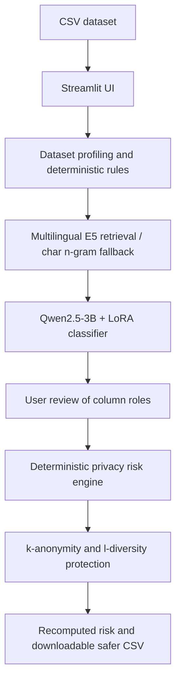

<div align="center">


  # MA'MAN | مَأْمَن

  ### Know your privacy risk before you share.

  **An AI-powered, local-first data privacy assessment and protection application.**

  [](https://www.python.org/)
  [](https://streamlit.io/)
  [](https://huggingface.co/Qwen/Qwen2.5-3B-Instruct)
  
  

  **[Watch the demo](assets/demo/maman-demo.mp4) · [Features](#key-features) · [Architecture](#system-architecture) · [Get started](#getting-started) · [Results](#evaluation-results)**

  <sub>مَأْمَن: نظام ذكي لتحليل مخاطر خصوصية البيانات وإنشاء نسخة أكثر أمانًا للمشاركة، مع دعم بيانات عربية وإنجليزية.</sub>
</div>

---

## The challenge

Removing names from a dataset does **not** necessarily protect the people behind its records. A combination of seemingly harmless fields—such as age, location, or occupation—can distinguish an individual record and may enable linkage with external information.

Organizations and data practitioners need a practical way to understand these risks **before** sharing a CSV file, without relying on an AI model to invent privacy scores or guarantee anonymity.

## Our solution

**MA'MAN** helps users inspect CSV datasets, identify privacy-relevant columns, quantify record distinguishability, and generate a safer copy for sharing.

Its guiding principle is simple:

> **AI interprets the columns. Deterministic code measures risk and applies protection.**

The application runs locally on supported Macs. Dataset contents are processed locally; initial setup downloads model dependencies. MA'MAN accepts **Arabic and English data**, while the current interface is **English-only**.

## See MA'MAN in action


## See MA'MAN in Action

Explore how MA'MAN transforms raw datasets into safer, privacy-aware data through AI-powered analysis and protection.

### 1. Upload Your Dataset
Upload a CSV file to begin the privacy analysis.


### 2. Dataset Overview
Preview your dataset and explore its structure before analysis.


### 3. AI-Powered Column Classification
MA'MAN uses AI to identify direct identifiers, quasi-identifiers, and sensitive attributes.


### 4. Privacy Risk Assessment
Analyze potential privacy risks and understand how identifiable the records may be.


### 5. Privacy Protection Results
Compare privacy risks before and after applying protection techniques.


### Product walkthrough

| Upload a CSV | Review privacy risk |
|:---:|:---:|
|  |  |
| Generate a safer copy | Inspect the protected data |
|  |  |

## Key features

- **Context-aware CSV ingestion:** detects delimiters and encodings, handles surrounding report text, and distinguishes person-level records from aggregate tables.
- **Hybrid AI column classification:** deterministic rules for recognizable identifiers plus **Qwen2.5-3B**, **LoRA**, and retrieval-augmented examples.
- **Multilingual semantic retrieval:** `intfloat/multilingual-e5-small` retrieves three relevant examples; a character n-gram fallback is available.
- **Reviewable classification:** users can inspect and correct inferred column roles.
- **Code-based privacy risk scoring:** a transparent 0–100 indicator based on equivalence-group sizes, not an LLM-generated score.
- **Safer-copy generation:** suppresses, masks, or generalizes attributes according to their role and the protection rules; uses **k-anonymity** and **l-diversity** checks.
- **Before/after assessment:** recalculates the indicator for the exported copy and provides a downloadable CSV and report.
- **Local-first execution:** the workflow does not require uploading the dataset to a hosted inference service.

## How it works

1. **Upload** a CSV dataset and inspect its structure.
2. **Profile** the dataset and identify whether rows represent people, aggregates, or uncertain/mixed content.
3. **Classify** each column using explicit rules and a fine-tuned, retrieval-augmented language model.
4. **Review** detected roles, including direct identifiers, quasi-identifiers, sensitive attributes, and record identifiers.
5. **Measure** distinguishability using the privacy risk engine.
6. **Protect** the data with masking, suppression, and coordinated generalization where appropriate.
7. **Reassess and export** a safer CSV copy and a risk report.

## System architecture



**Division of responsibility:** the LLM helps interpret column semantics and produce explanations. Privacy scores and transformations are computed by Python code.

## Privacy model and limitations

For person-level records, MA'MAN uses a risk indicator based on the average reciprocal equivalence-class size:

\[
\mathrm{Risk\ Score}=100\times\frac{1}{n}\sum_{i=1}^{n}\frac{1}{k_i}
\]

Here, `kᵢ` is the number of records sharing the identifying combination considered by the engine for record `i`.

| Indicator | Displayed level |
|---|---|
| 0–10 | Low |
| >10–33.3 | Medium |
| >33.3–66.7 | High |
| >66.7–100 | Critical |

Some aggregate datasets are **not scored** under the person-level model; the application handles these separately. The score is an **indicator of within-dataset distinguishability, not the probability of identifying a person**. Low risk does **not** mean guaranteed anonymity or immunity to linkage with other sources.

## Evaluation results

Column-role classification was evaluated on **102 columns from nine held-out datasets**. The full annotated collection contains **236 columns from 20 datasets**, divided into 110 training, 24 validation, and 102 test columns.

| Method | Macro-F1 | Exact match |
|---|---:|---:|
| kNN baseline | 0.564 | 46.1% |
| Zero-shot | 0.655 | 48% |
| RAG only | 0.664 | 55% |
| LoRA fine-tuning only | 0.723 | 56% |
| LoRA + RAG (character n-grams) | 0.856 | 72.5% |
| **LoRA + RAG (multilingual E5)** | **0.876** | **75.5%** |

**Macro-F1** averages F1 across four evaluated column roles; **exact match** requires all evaluated roles for a column to be correct. E5 versus character n-grams was **not statistically significant** in the reported comparison (`p ≈ 0.65`). Because the final configuration was selected using the same test set, these results may be optimistic and should be confirmed on a new independent holdout.

### Demonstration: German Credit

The presentation documents an application run on **1,000 records**:

| Measure | Before protection | After protection |
|---|---:|---:|
| MA'MAN risk indicator | 99.7 / 100 | 0.9 / 100 |

A separate, assumption-specific linkage simulation sampled 500 records: **496/500** were uniquely linked after name removal alone; **0/500** were linked under the same test conditions after protection. This is **not** proof that re-identification is impossible under different auxiliary information or attack assumptions.

Supporting outputs are available in `outputs/`, including `final_eval.md`, `retriever_eval.md`, and evaluation JSON files. The simulation code is in `scripts/linkage_attack.py`.

## Getting started

### Requirements

- **macOS on Apple Silicon (M1 or newer)**
- **Python 3.11+** (project documentation reports testing with Python 3.14)
- Preferably **16 GB RAM** (8 GB may work with other applications closed)
- Internet access for initial package and model downloads (subsequent inference runs locally)

### Run the application

1. Clone or download this repository and open its root folder.
2. Double-click **`run_app.command`** on macOS. On the first run, it sets up the environment and downloads required models.
3. Alternatively, run:

```bash
cd Maman
bash run_app.command
```

4. Open **http://localhost:8501** if it does not open automatically.
5. Upload a CSV file, review column classifications, run the risk assessment, and download the safer copy.

For an initial local test, the repository includes `data/holdout/sa_gym_members.csv`. Do not publish or share private datasets without authorization.

**Model downloads:** the setup script fetches `mlx-community/Qwen2.5-3B-Instruct-4bit` and `intfloat/multilingual-e5-small` from Hugging Face. Their model licenses and usage terms are governed by the upstream repositories.

**Fallback retrieval:** run `bash run_app_char.command` to use character n-gram retrieval rather than multilingual E5.

### Run tests

```bash
bash tests/run_tests.command
```

For extended checks, see `tests/final_checks.command`. The evaluation artifacts in this repository reflect project experiments; they are not a substitute for independently reproducing the results on your machine.

## Repository structure

```text
Maman/
├── app.py                    # Streamlit interface
├── requirements.txt          # Python dependencies
├── setup.command             # First-time environment setup
├── run_app.command           # Launch application
├── run_app_char.command      # Character n-gram fallback
├── scripts/                  # Classification, profiling, risk and evaluation
├── adapters_rag/             # Fine-tuned adapter for RAG workflow
├── adapters/                 # Fine-tuned adapter without RAG
├── data/                     # Examples, annotations and holdout data
├── training_data/            # Model training examples
├── training_data_rag/        # Retrieval-augmented training examples
├── tests/                    # Automated tests and test fixtures
├── outputs/                  # Evaluation reports and experiment artifacts
└── assets/                   # Brand, screenshots and demo video
```

## Data, responsible use and future work

The project includes Arabic-oriented synthetic example datasets, evaluation materials, and sample files. **Before public release, review each included dataset and its redistribution license or provenance.** Do not assume that publicly downloadable data is automatically redistributable. Avoid committing personal information, API keys, local environments, or private reports.

MA'MAN is a **decision-support tool**, not a legal compliance certification or an unconditional anonymization guarantee. A safer copy can still expose information under other threat models. Human review remains important before publishing sensitive data.

Planned improvements include an independent external evaluation, tests with authorized real-world datasets, and reduced startup time and memory consumption.

## Team

**Team 8 — Tuwaiq Generative AI / LLM Bootcamp**

**Wafa · Samar · Sultanah · Bushra**

> Confirm team names, spelling, and individual responsibilities before publishing. The presentation lists three presenters while the existing repository documentation lists four contributors.

## Acknowledgments

Developed as part of the Tuwaiq LLM Bootcamp. Built using open-source tools and models including Streamlit, Qwen, MLX, and multilingual E5. Their respective trademarks and licenses belong to their owners.

---

<div align="center">
  <strong>MA'MAN — Understand the risk. Protect the data. Share with greater confidence.</strong>
</div>
